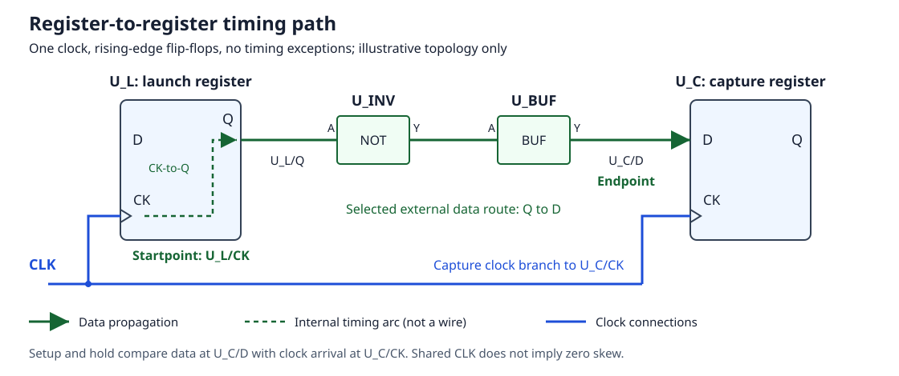

# 001. STA fundamentals, purpose, and limitations

- **Date:** 2026-11-13
- **Revised:** 2026-11-18
- **Status:** done (findings and evidence ready; tracker closure is separate)
- **Issue:** [R1, #23](https://github.com/kastor-st/kastor-sta/issues/23), under
  [research epic #8](https://github.com/kastor-st/kastor-sta/issues/8)
- **Time box:** 8 hours, as specified in R1.

## Question

What is Static Timing Analysis, how does it work conceptually, and why is it
necessary in digital circuit design?

Scope: conceptual digital IC timing, primarily synchronous standard-cell logic.
Detailed equations, propagation algorithms, advanced delay models, asynchronous
design methods, and CDC verification procedures are excluded by R1.

## Sources

Source IDs below resolve to public bibliographic or primary documentation links
in the [source register and evidence review](assets/001-sta-fundamentals/evidence.md#source-register).
The textbooks are B1 (Bhasker and Chadha, 2009) and B2 (Mano and Ciletti,
sixth edition, Global Edition, 2019). Online corroboration uses Synopsys (W1), pinned OpenSTA
documentation (W2), AMD guides (W3/W4/W7), the ngspice manual (W5), MIT's
sequential-logic lecture (W6), and OpenLane's timing-closure guide (W8).

## What I learned

STA checks whether modeled signal transitions meet specified timing requirements
without executing input-vector sequences. It gives broad timing coverage at a
practical cost, but its conclusions are conditional on the circuit model,
constraints, exceptions, and operating scenarios. It complements functional
verification and simulation; it does not establish that the circuit implements
the intended computation. [B1 §§1.2–1.6]

### 1. What is STA, and what problems does it solve?

STA is a method for analyzing and verifying the timing of digital circuits.
Depending on the objective of IC design, it helps answer two main questions:

1. What is the highest frequency at which the circuit can operate under the
   assumed timing conditions?
2. Does the circuit meet the specified timing constraints, such as the target
   clock frequency and interface requirements? In other words, are there any
   timing violations?

Other questions follow from these: which paths violate the constraints and
where timing improvements are needed. Estimating a maximum operating frequency
still requires defined clocks, interfaces, operating conditions, and checks;
it is not an analysis without constraints. [B1 §§1.2–1.3, 2.8]

STA uses timing models without requiring input stimulus sequences. This is an
important reason for its speed and coverage compared with timing simulation;
both methods can be used before a physical chip exists. Its accuracy depends
on the models and assumptions. Actual delays depend on process, supply voltage,
temperature, signal transitions, loading, and interconnect. [B1 §§1.3, 2.2, 2.10]

### 2. Why is timing verification necessary, and how does it differ from functional correctness?

Timing verification is necessary to determine whether a circuit can operate
under its intended timing conditions. If the clock is too fast, data may arrive
too late to be captured correctly, even when the original RTL model is
functionally correct. For ordinary fully static synchronous logic, slowing the
clock generally helps setup timing, but does not repair a same-edge hold
violation. A lower frequency limit needs a specific device or interface reason.
[B1 §§8.1–8.2]

Functional correctness asks whether the circuit computes the intended result
from its inputs and state. Timing correctness asks whether signals become
valid and remain stable when required. Both are necessary for correct physical
operation. STA alone is insufficient for functional verification: a circuit
may meet its timing constraints yet produce the wrong result for a particular
input sequence. [B1 §1.2; B2 §4.3]

### 3. At which design-flow stages is STA performed?

STA can be performed during and after many stages of IC implementation,
depending on how the tools use timing information to make decisions. The flow
has two main groups of stages: logical and physical. Logical stages include
synthesis and logic optimization. Timing analysis helps identify and address
problems before the design enters physical implementation.

Physical stages include global and detailed placement, clock-tree synthesis,
and global and detailed routing. STA can guide decisions within a stage and
check its timing goals afterwards. Early analysis uses estimates for
interconnect and clock behavior; after detailed routing, analysis can use
extracted parasitics and the implemented clock network. This provides more
representative physical information, but the models and constraints must still
be appropriate. Behavioral RTL alone is insufficient for final timing
sign-off, and passing an intermediate check is not final chip sign-off.
[B1 §§1.4–1.5, Fig. 1-2]

### 4. What are combinational and sequential logic?

Combinational logic implements Boolean functions. It receives N input signals
and produces M output signals whose settled values depend only on the current
inputs. It does not retain logical state, but signals still take time to
propagate through it. A combinational block has no independent one-clock-period
budget: its available time depends on the surrounding path and constraints.
[B2 §§4.1–4.2; B1 §8.1]

Sequential logic combines logic with storage, so its behavior depends on both
input signals and internal state. A level-sensitive D latch follows its data
input while enabled and retains its value while disabled. A flip-flop samples
data around its active clock edge; its output responds after a propagation
delay. A register groups stored bits. Both latches and flip-flops can be used
in synchronous designs. [B2 §§5.2–5.4, pp. 262–272; W6]

### 5. What are synchronous and asynchronous circuits?

A clock coordinates when storage elements in a synchronous sequential circuit
update their state. In an asynchronous sequential circuit, state changes depend
on input events and their ordering without a common clock governing all those
updates. The distinction concerns how state changes are coordinated, not simply
whether the circuit contains latches or flip-flops. [B2 §5.2]

Modern designs can combine these styles, including synchronous blocks that
communicate asynchronously. Combinational logic can occur within either style;
having no storage does not make it an asynchronous sequential circuit.
Asynchronous circuits still have timing requirements, although ordinary
single-cycle setup and hold checks do not describe all of them.
[B1 §1.4.3; W4]

### 6. What are clock signals and clock domains?

A clock is a signal used to coordinate circuit operation. In a simple timing
model it is periodic, but its real behavior includes variation in edge timing
(jitter) and distribution delay. Different clock arrival times at receiving
pins produce clock skew. [B1 §2.6]

A simple circuit may have one clock connected to its flip-flops through a clock
tree. More complex circuits can contain multiple clocks. The sequential elements
driven by a given clock form a clock domain. Analysis becomes more complicated
when data starts in one domain and ends in another. The clocks may have a defined
relationship, such as a derived clock, or no dependable phase relationship.
Different domain names do not automatically mean asynchronous clocks, and equal
nominal frequency does not establish synchronization. [B1 §2.9; W2/W4]

### 7. What is a timing path, with startpoint and endpoint?

STA analyzes signal propagation in terms of timing paths. For the ordinary data
paths considered here, a path starts at an input port or a launching register
and ends at a receiving register's data input or an output port. Combinational
cells and interconnect between those points introduce delay. The four common
classes are input-to-register, register-to-register, register-to-output, and
input-to-output. [W1]

For the register-to-register diagram below, the launch timing reference is
**U_L/CK**. The path includes the register's clock-to-Q timing arc, followed by
the external data route from **U_L/Q** through the inverter and buffer to
**U_C/D**, the endpoint. A report may name the launching register as its
startpoint. Arrival of the capture clock at **U_C/CK** is also needed for the
timing check. [B1 §§2.8, 8.1–8.2]

In the simple same-clock, single-cycle setup case, data launched on one edge
must be ready for the next capture edge. This is not a universal one-period
rule: clock relationships, multicycle paths, and I/O constraints can define
different requirements. The entire path shares the available timing budget.
[B1 §§1.6, 8.1]

The drawing assumes rising-edge flip-flops sharing one clock, one combinational
route, and no timing exceptions. The dashed internal arrow is a timing arc, not
a wire. See the [diagram interpretation](assets/001-sta-fundamentals/evidence.md#diagram-interpretation).

### 8. What are setup and hold requirements?

Waveform drawings often show instantaneous transitions, but physical signals
take time to rise and fall. That affects timing, but finite clock rise time
alone is not the reason for setup and hold requirements. A storage element's
internal circuit needs data to remain stable around the capture event. Signal
slew can affect the characterized requirements. [B1 §3.4; W6]

In the introductory positive-time case, setup specifies how long data must be
stable **before the active capture edge**, and hold specifies how long it must
remain stable **after that edge**. A violation may cause an incorrect capture
or metastability, where the internal state takes longer to resolve to a stable
logic value; failure need not occur on every capture. [B2 §§5.3–5.4; B1 §§8.1–8.2]

Setup concerns late arrival; hold concerns new data arriving too early. Both
depend on data and clock timing. For ordinary same-clock, same-edge hold checks,
increasing the period does not solve the violation. Library constraints may
have signed values, so the positive-interval picture is a starting point,
not a universal rule for every cell. [B1 §§3.4, 8.1–8.2]

### 9. How does STA check timing without stimulus vectors?

To check a path, STA needs information about the circuit's components and their
connections. These may be standard cells in an ASIC flow or resources such as
D flip-flops and lookup tables in an FPGA flow. The analyzer combines cell
timing models, interconnect delays, clock timing, and constraints. When cells
have not yet been placed or connections routed, some physical information must
be estimated. Those estimates are themselves models and can be refined as
implementation progresses. [B1 §§1.4–1.5]

Conceptually, STA accumulates and propagates early and late transition timing
through the circuit and compares arrivals with requirements. Late timing is
needed for setup checks; early timing is needed for hold checks. A timing graph
lets the analyzer share calculations rather than simulate every input sequence
or enumerate every complete path separately. [B1 §§8.1–8.2; W2]

This provides broad coverage of the modeled timing checks without stimulus
vectors. It does not unconditionally prove correct hardware operation: valid
models, complete constraints, justified exceptions, and appropriate scenarios
are all necessary. For example, OpenSTA documents that normal timing-check
reports can omit unconstrained paths. A clean report therefore does not by
itself establish that every required path was checked. [B1 §1.6; W2]

### 10. What are timing violations and critical paths?

When STA finds a path that does not meet a timing requirement, it reports a
violation. Even one valid violation means the configured timing requirements
have not all been met. It does not mean the hardware must fail on every input
sequence, or that changing the clock period will fix every kind of violation.
The constraints and the validity of the path also need to be checked.
[B1 §§1.6, 8.1–8.2]

Slack expresses the remaining timing margin; negative slack indicates an unmet
check. A critical path is the path with the least slack within the relevant
check group and scenario. It can exist even when the design passes. Engineers
and optimization algorithms use critical paths to identify where improvements
matter most. [B1 §8.1; W8]

Criticality is relative to the constraints and scenarios, but ordinary STA does
not define it as a probability of failure. A tool may report the worst 100 paths
or select paths below a margin threshold; those are reporting or optimization
policies. They do not change the underlying comparison of timing margins.
The longest-delay path is not necessarily the least-slack path when requirements
differ, and hold analysis concerns early arrivals. [B1 §§2.8, 8.1–8.2;
interpretation of slack-based ranking]

### 11. What is dynamic timing analysis, and how does gate-level timing simulation differ?

Dynamic timing analysis follows a circuit's behavior over time for specified
stimuli. Gate-level timing simulation is one such method: it applies input
vectors to a gate netlist and uses simulation models with delays and timing
checks, often annotated through Standard Delay Format (SDF). It still uses
models; its distinction from STA is the execution of particular sequences.
A zero-delay functional simulation is not a timing simulation. [B1 §§1.2–1.3;
W3/W7]

The testbench can also compare the circuit's responses with expected results,
checking functional behavior for the sequences exercised. Simply producing a
waveform does not automatically verify that the behavior is correct.
[B2 §4.3; interpretation of simulation-based verification]

### 12. What are their advantages, limitations, and complementary uses?

STA checks timing broadly without needing input sequences. Dynamic simulation
shows what happens for the supplied sequences, which is useful for debugging
reset, startup, and other integration behavior. Simulation coverage depends on
the stimuli; STA coverage depends on the modeled and constrained checks.
[B1 §§1.3, 1.6]

Neither method is inherently more accurate in every situation. Model fidelity
and settings affect both, and electrical accuracy is a different question from
how many scenarios were covered. STA does not establish intended functionality;
simulation can check it for exercised cases but does not establish behavior
for every untested sequence. They complement functional verification and CDC
review. [B1 §§1.2–1.6; W4]

| Approach | Stimulus and model | Useful result | Principal limitation |
| --- | --- | --- | --- |
| STA | Timing models and constraints; no input sequence required | Timing margins and limiting paths across the configured analysis | Conditional on model and constraint coverage; no functional proof |
| Gate-level timing simulation | Input sequences, gate models, and delays | Time-dependent logical responses and modeled timing failures | Only exercised sequences are checked |
| Circuit-level transient simulation | Electrical models and input waveforms | Voltage/current behavior beyond a gate timing abstraction | Model-dependent results for selected electrical scenarios |

The [supporting comparison](assets/001-sta-fundamentals/evidence.md#comparison-of-analysis-approaches)
records additional limitations. The circuit-level method is discussed next.
[B1 §§1.2–1.6; W3/W5]

### 13. When is circuit-level simulation such as SPICE needed?

Even after digital timing checks pass, there may be questions about the physical
implementation that those checks do not answer. SPICE refers to a family of
circuit simulators. Transient circuit simulation uses device and interconnect
models to examine voltage and current waveforms under specified input signals
and initial conditions. It can help explain electrical effects that are not
represented sufficiently by a digital timing abstraction. [W5]

For example, a custom transistor-level cell may need its output waveform checked
under different loads before its timing behavior is adequately characterized.
This is a reason to use circuit simulation alongside STA, not a mandatory final
pass for every design. Results still depend on models, stimuli, and numerical
settings; a successful run does not guarantee correct operation of the entire
fabricated chip. [B1 §§1.6, 2.2; W5; example is application guidance]

### 14. Under what assumptions are STA results valid, and what does passing not establish?

STA results are valid within the assumptions of the analysis. The netlist must
represent the intended implementation and operating mode. Timing models and
interconnect information must be appropriate; clocks, input/output constraints,
and exceptions must be complete and justified. The analysis must cover the
relevant operating conditions and checks, including both early and late timing.
Passing one scenario does not establish that every other scenario passes.
[B1 §§1.6, 2.10; W2]

Passing STA does not establish the intended logic function, correct reset or
startup sequencing, correct clock configuration, safe asynchronous
clock-domain crossings, or behavior outside the electrical models. These need
complementary verification. The [validity review](assets/001-sta-fundamentals/evidence.md#validity-and-limitations)
gives the assumptions in more detail. [B1 §1.6; W4]

With these qualifications, STA is an effective way to verify circuit timing.
It identifies timing problems early and provides information that implementation
tools and engineers can use to improve timing throughout the design flow.

## Evidence and reproducibility

The [evidence review](assets/001-sta-fundamentals/evidence.md) maps every question
to source sections, compares the approaches, records the important conceptual
qualifications, and identifies the cited editions and printed page numbers.
The diagram is an original, editable SVG. No numerical experiment, STA run,
SPICE run, benchmark, or accuracy measurement is claimed or needed for R1.

## Open questions

None within R1's agreed scope. The next topics already have issues:
[R2a #24](https://github.com/kastor-st/kastor-sta/issues/24) for timing graphs and
arrival propagation, [R2b #25](https://github.com/kastor-st/kastor-sta/issues/25)
for numerical setup/hold calculations, and
[R3c #29](https://github.com/kastor-st/kastor-sta/issues/29) for constraints.
Detailed CDC and analog verification remain outside this research scope.

## Impact on the project

No immediate ADR, architecture, or requirements change follows. This note
provides terminology and limitations for the research cycle. It does not select
supported formats, delay models, clocking features, or sign-off capability for
Kastor STA; those commitments belong to later research and requirements work.
